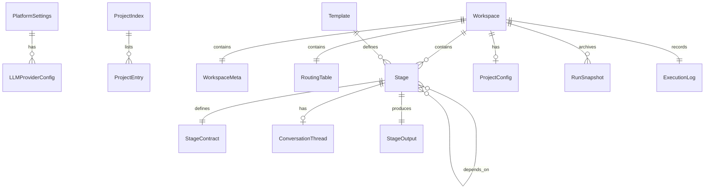

# Data Model: Human-AI Collaboration Platform (HACP)

**Date**: 2026-05-16  
**Source**: [ai-human-collab-spec.md](ai-human-collab-spec.md) Key Entities + Functional Requirements

---

## Entity Relationship Diagram (Mermaid)



---

## Entities

### 1. PlatformSettings

**Location**: `~/.hacp/settings.json` + OS keychain  
**Source**: FR-080–FR-091, Key Entity "Platform Settings"

| Field | Type | Required | Description |
|-------|------|----------|-------------|
| defaultProvider | string | yes | ID of the default LLM provider |
| providers | LLMProviderConfig[] | yes | All configured LLM providers |
| workspaceDefaults.rootDir | string | yes | Default root directory for new workspaces |
| workspaceDefaults.namingConvention | `"01_name"` \| `"001_name"` | yes | Stage folder numbering format |
| workspaceDefaults.autoCreateConversation | boolean | yes | Whether to create conversation.md in new stages |
| ui.theme | `"light"` \| `"dark"` \| `"system"` | yes | Color theme |
| ui.editorFontSize | number | yes | Editor font size in px |
| ui.activityFeedVisible | boolean | yes | Activity feed default visibility |
| ui.notificationSound | boolean | yes | Enable notification sounds |
| version | string | yes | Settings schema version |

### 2. LLMProviderConfig

**Nested in**: PlatformSettings  
**Source**: FR-081, FR-083, FR-086, FR-091

| Field | Type | Required | Description |
|-------|------|----------|-------------|
| id | string | yes | Unique provider identifier |
| type | `"openai"` \| `"anthropic"` \| `"google"` \| `"ollama"` \| `"openai-compatible"` | yes | Provider type |
| baseUrl | string | no | Custom endpoint URL (for ollama, openai-compatible) |
| defaultModel | string | yes | Default model ID (e.g., "gpt-4o", "claude-sonnet-4") |
| apiKeyRef | string | yes | Reference key for OS keychain lookup |
| parameters.temperature | number | no | Default temperature (0.0–2.0) |
| parameters.maxTokens | number | no | Default max output tokens |
| parameters.systemPromptPrefix | string | no | Prefix prepended to all system prompts |

**Validation**:
- `temperature` must be between 0.0 and 2.0
- `apiKeyRef` must resolve to a non-empty value in OS keychain

### 3. ProjectIndex

**Location**: `~/.hacp/projects.json`  
**Source**: FR-047, Key Entity "Project Index"

| Field | Type | Required | Description |
|-------|------|----------|-------------|
| version | string | yes | Index schema version |
| projects | ProjectEntry[] | yes | All known projects |

### 4. ProjectEntry

**Nested in**: ProjectIndex  
**Source**: FR-046, FR-050, FR-051

| Field | Type | Required | Description |
|-------|------|----------|-------------|
| id | string | yes | UUID |
| name | string | yes | Project display name |
| path | string | yes | Absolute path to workspace folder |
| status | ProjectStatus | yes | Current status |
| tags | string[] | no | User-defined labels |
| createdAt | ISO8601 | yes | Creation timestamp |
| lastModifiedAt | ISO8601 | yes | Last modification timestamp |
| archived | boolean | yes | Whether project is archived |

**Enum ProjectStatus**: `"Draft"` | `"Running"` | `"Paused"` | `"Completed"` | `"Failed"`

### 5. Workspace (on-disk folder)

**Location**: User-selected path  
**Source**: FR-035, FR-036, FR-045, FR-052, Key Entity "Workspace"

| Component | Path | Layer | Description |
|-----------|------|-------|-------------|
| Meta | `WORKSPACE.md` | 0 | Project identity: name, description, dates, status, stage summary |
| Routing | `CONTEXT.md` | 1 | Stage routing table: all stages, order, dependencies, assignee types |
| Stages | `stages/` | — | Container for numbered stage folders |
| Config | `_config/project-brief.md` | 3 | Project brief (user's initial description) |
| Config | `_config/conventions.md` | 3 | Project-wide conventions |
| Config | `_config/llm.json` | 3 | (Optional) Project-level LLM overrides |
| Log | `run-log.md` | — | Append-only execution log |
| Runs | `_runs/` | — | Archived run snapshots |
| Shared | `shared/` | 3 | Reusable reference materials |

### 6. WorkspaceMeta (WORKSPACE.md parsed)

**Source**: FR-052

| Field | Type | Required | Description |
|-------|------|----------|-------------|
| projectName | string | yes | Project title |
| description | string | yes | Project description |
| createdAt | ISO8601 | yes | Creation date |
| lastModifiedAt | ISO8601 | yes | Last modified date |
| workflowStatus | WorkflowStatus | yes | Current workflow status |
| stageSummary | StageSummaryEntry[] | yes | One-line per stage: number, name, assignee, status |

**Enum WorkflowStatus**: `"Draft"` | `"Running"` | `"Paused"` | `"Completed"` | `"Failed"`

### 7. RoutingTable (CONTEXT.md parsed)

**Source**: FR-039

| Field | Type | Required | Description |
|-------|------|----------|-------------|
| stages | RoutingEntry[] | yes | Ordered list of all stages |

| Sub-field | Type | Description |
|-----------|------|-------------|
| RoutingEntry.number | number | Stage sequence number (01, 02, …) |
| RoutingEntry.name | string | Stage folder name (e.g., `01_research`) |
| RoutingEntry.assignee | `"AI"` \| `"Human"` | Who executes this stage |
| RoutingEntry.dependsOn | number[] | Stage numbers this depends on |
| RoutingEntry.parallel | boolean | Whether this stage runs in parallel group |

### 8. Stage (on-disk folder)

**Location**: `stages/NN_name/`  
**Source**: FR-037, FR-038, Key Entity "Stage"

| Component | Path | Description |
|-----------|------|-------------|
| Contract | `CONTEXT.md` | Stage contract (Layer 2) |
| References | `references/` | Stage-specific reference material (Layer 3) |
| Output | `output/` | Working artifacts (Layer 4) |
| Conversation | `conversation.md` | AI-Human conversation thread (optional) |
| Draft | `.draft.md` | Auto-saved editor draft (FR-099, hidden file) |

### 9. StageContract (CONTEXT.md parsed)

**Source**: FR-038

| Field | Type | Required | Description |
|-------|------|----------|-------------|
| title | string | yes | Stage display name |
| description | string | no | Detailed description of the stage |
| assignee | `"AI"` \| `"Human"` | yes | Who executes this stage |
| model | string | no | LLM model override (e.g., "claude-sonnet-4") |
| inputs | InputRef[] | yes | Files/folders to read |
| process | string | yes | Action description (prompt for AI, task brief for human) |
| outputs | string[] | yes | Expected output file names |

| Sub-field | Type | Description |
|-----------|------|-------------|
| InputRef.type | `"reference"` \| `"upstream_output"` \| `"config"` | Source category |
| InputRef.path | string | Relative path within workspace |

**Validation**:
- `assignee` must be "AI" or "Human"
- `inputs` must not reference non-existent files (validated at execution time)
- `outputs` must have at least one entry

### 10. StageStatus

**Source**: FR-010

**Enum**: `"Pending"` | `"InProgress"` | `"AwaitingHuman"` | `"Completed"` | `"Failed"`

**State Machine**:
```
Pending → InProgress        (execution started)
InProgress → Completed      (output written successfully)
InProgress → Failed         (error occurred)
InProgress → AwaitingHuman  (human stage reached)
AwaitingHuman → InProgress  (user submitted output)
Failed → InProgress         (retry)
Failed → AwaitingHuman      (mark as human — FR-097)
Completed → Pending         (re-run triggered)
```

### 11. RunSnapshot

**Location**: `_runs/run-YYYY-MM-DDTHH-MM/`  
**Source**: FR-054, FR-058, Key Entity "Run Snapshot"

| Field | Type | Description |
|-------|------|-------------|
| timestamp | ISO8601 | When the run was archived |
| fromStage | number | Stage number from which re-run was triggered |
| stages | string[] | Stage folders included in this snapshot |
| status | `"completed"` \| `"partial"` | Whether all stages finished |

Each snapshot folder mirrors the stage output structure:
```
_runs/run-2026-05-16T14-30/
├── metadata.json           # Snapshot metadata
├── 02_analysis/output/     # Archived output files
└── 03_report/output/
```

### 12. ExecutionLogEntry

**Location**: `run-log.md` (workspace root, append-only)  
**Source**: FR-026, FR-098, Key Entity "Execution Log"

| Field | Type | Description |
|-------|------|-------------|
| timestamp | ISO8601 | Event time |
| event | EventType | What happened |
| stage | string | Stage reference (e.g., "01_research") |
| actor | `"AI"` \| `"Human"` \| `"System"` | Who triggered it |
| details | string | Event-specific details |
| duration | number | Milliseconds (for stage completion events) |
| error | string | Error message (for failure events) |

**Enum EventType**: `"stage_started"` | `"stage_completed"` | `"stage_failed"` | `"human_notified"` | `"human_submitted"` | `"workflow_started"` | `"workflow_paused"` | `"workflow_completed"` | `"rerun_triggered"` | `"file_edited"` | `"conversation_message"`

### 13. ConversationThread

**Location**: `stages/NN_name/conversation.md`  
**Source**: FR-060–FR-065, Key Entity "Conversation Thread"

| Field | Type | Description |
|-------|------|-------------|
| stageRef | string | Parent stage folder name |
| messages | ConversationMessage[] | Ordered message history |

| Sub-field | Type | Description |
|-----------|------|-------------|
| ConversationMessage.role | `"user"` \| `"assistant"` | Message sender |
| ConversationMessage.content | string | Message text (markdown) |
| ConversationMessage.timestamp | ISO8601 | When sent |
| ConversationMessage.runSeparator | boolean | If true, marks a re-run boundary |

### 14. Template

**Location**: `~/.hacp/templates/` or bundled  
**Source**: FR-066–FR-069, Key Entity "Project Template"

| Field | Type | Description |
|-------|------|-------------|
| id | string | Unique template identifier |
| name | string | Display name |
| description | string | What this template is for |
| stageCount | number | Number of pre-defined stages |
| builtIn | boolean | Whether this is a bundled template |
| path | string | Path to template workspace folder |

### 15. ActivityEvent (derived, not persisted separately)

**Source**: FR-075, Key Entity "Activity Event"

| Field | Type | Description |
|-------|------|-------------|
| timestamp | ISO8601 | Event time |
| message | string | Human-readable description |
| stageRef | string | Related stage (if any) |
| actor | `"AI"` \| `"Human"` \| `"System"` | Who triggered it |
| type | EventType | Event category (same enum as ExecutionLogEntry) |

*Derived from ExecutionLog entries — not a separate data store.*

### 16. Notification

**Source**: FR-017, FR-021, Key Entity "Notification"

| Field | Type | Description |
|-------|------|-------------|
| id | string | UUID |
| type | `"human_required"` \| `"reminder"` \| `"error"` \| `"completion"` | Notification category |
| stageRef | string | Related stage |
| projectId | string | Related project |
| message | string | Display text |
| timestamp | ISO8601 | When created |
| read | boolean | Whether user has seen it |
| actionUrl | string | Deep link to the relevant stage |

*Stored in-memory only (single user, single session). Derived from workflow events.*
